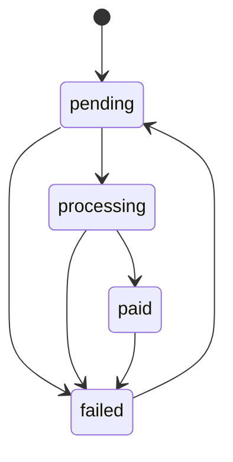
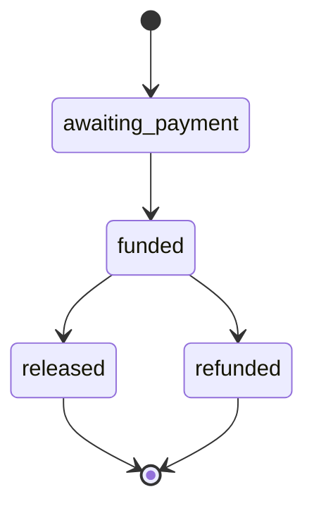
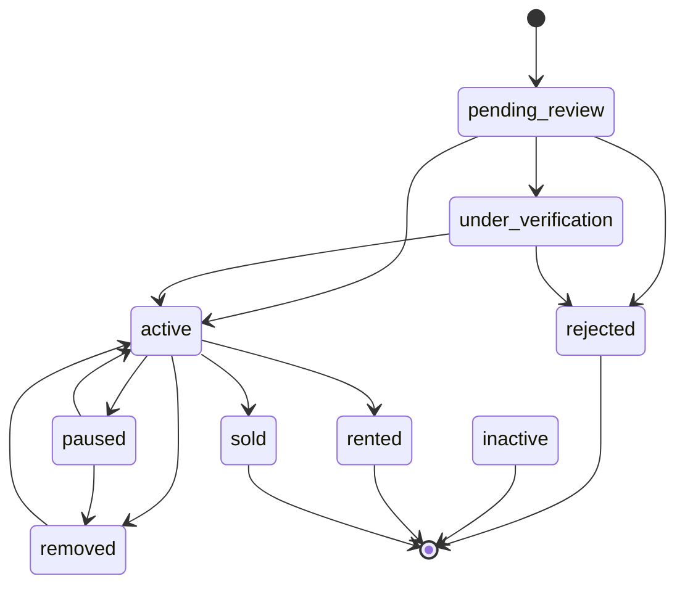
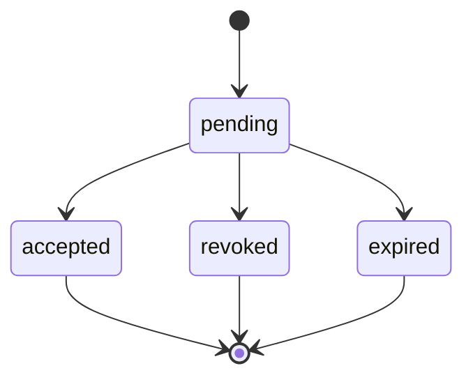

<!-- Generated by `npm run docs:states` from src/lib/stateMachines.js. Do not edit by hand. -->
# State machines

Every status column in the app, the values it may hold, and who enforces them. The registry in `src/lib/stateMachines.js` only *describes* behaviour; nothing at runtime reads it.

**Before you add or change a status:** find its entry here, read its `notes`, change the database CHECK/enum and the code that writes it together, then update the registry and run `npm run docs:states`. If the machine is only catalogued, write its transition table from the code and flip it to modelled.

Modelled: 4. Catalogued (values only): 44.

Enforcement: `transition-trigger` = the database rejects illegal moves; `conditional-update` = code writes `.eq(status, from)`; `check-constraint` = only the value is checked; `none` = nothing.

## Modelled machines

### payout_queue

`payout_queue.status` · starts at `pending` · enforced by transition-trigger, conditional-update · owner `src/lib/payoutStates.js`



### escrow

`escrow_transactions.status` · starts at `awaiting_payment` · enforced by check-constraint, conditional-update · owner `src/data/escrowRepository.js`



> Migration 20261109000000 (PR #65) sets the database default to awaiting_payment and adds a CHECK on these values plus legacy "pending", which account_deletion_blockers still reads.

### property

`properties.status` · starts at `pending_review` · enforced by check-constraint · owner `src/data/manageListingsRepository.js`



> Owners pause with "paused" and delete with "removed" (from migration 20261108000000, PR #63). Before it, the database refused "paused" from an owner, so Manage listings paused with "removed" and the landlord dashboard pause button failed. Old "removed" rows still show as paused and can be restored. "inactive" is in the CHECK list but nothing writes it. The database default is "active", while new listings are inserted as "pending_review".

### staff_invite

`staff_invites.status` · starts at `pending` · enforced by check-constraint · owner `supabase/migrations/20260828000004_staff_invite_flow.sql`



## Catalogued machines (values only)

| Machine | Column | Starts at | Values | Enforced by | Notes |
| --- | --- | --- | --- | --- | --- |
| dispute_case | `disputes.case_state` | `open` | open, awaiting_response, under_review, escalated, resolved | transition-trigger | trg_guard_dispute_client_write limits what a client may write. A resolved case with a transaction must carry a decision, reason and time (CHECK). |
| dispute_status | `disputes.status` | `open` | open, investigating, resolved, dismissed | check-constraint |  |
| student_hostel | `student_hostels.status` | `pending_review` | pending_review, active, paused, rejected, filled | check-constraint | Admin tab: active <-> paused, approve/reject from pending_review. |
| booking | `bookings.status` | `confirmed` | pending, confirmed, cancelled, completed | check-constraint |  |
| transaction_payout | `transactions.payout_status` | `not_queued` | not_queued, queued, paid, failed | check-constraint |  |
| identity_verification | `profiles.identity_verification_status` | `unverified` | unverified, submitted, approved, rejected | transition-trigger | trg_guard_profile_identity and trg_lock_sensitive_profile_columns restrict client writes. |
| account | `profiles.account_status` | `active` | active, suspended, deleted | none | No CHECK constraint. Values seen in code: active, suspended, deleted. |
| professional_application | `professional_applications.status` | `pending` | pending, approved, rejected, paused | check-constraint |  |
| professional_request | `professional_requests.status` | `pending` | pending, connected, completed, cancelled | check-constraint |  |
| student_verification | `student_verifications.status` | `pending` | pending, approved, rejected | check-constraint |  |
| verification_submission | `verification_submissions.status` | `pending` | pending, approved, rejected | check-constraint |  |
| verification_session | `verification_sessions.status` | `active` | active, consumed, expired, rejected | check-constraint |  |
| hostel_payment | `hostel_payments.status` | `pending` | pending, success, failed | check-constraint |  |
| virtual_account | `payment_virtual_accounts.status` | `pending` | pending, paid, underpaid, expired | check-constraint |  |
| payment_refund | `payment_refunds.status` | `to_refund` | to_refund, refunded, resolved | check-constraint |  |
| wallet_ledger | `wallet_ledger.status` | `pending` | pending, processing, paid, failed | check-constraint |  |
| complaint | `complaints.status` | `open` | open, under_review, upheld, dismissed, escalated | check-constraint | trg_process_complaint_resolution runs side effects when a complaint is decided. |
| report | `reports.status` | `open` | open, investigating, resolved, dismissed | check-constraint |  |
| contract | `contracts.status` | `draft` | draft, signed, executed, cancelled | check-constraint | trg_initialize_escrow runs when a contract changes. |
| deal_agreement | `deal_agreements.status` | `buyer_signed` | buyer_signed, lister_signed, completed, cancelled | check-constraint |  |
| bid | `bids.status` | `PENDING` | PENDING, ACCEPTED, DECLINED, WITHDRAWN | check-constraint |  |
| category_listing | `category_listings.status` | `ACTIVE` | ACTIVE, MATCHED, SUSPENDED, CLOSED | check-constraint |  |
| forum_thread | `forum_threads.status` | `OPEN` | OPEN, CLOSED, HIDDEN | check-constraint | HIDDEN = moderated; the URL stays live and returns 404 to crawlers. |
| property_inspection | `property_inspections.status` | `pending` | pending, scheduled, confirmed, completed, cancelled | check-constraint |  |
| property_interest | `property_interest.status` | `new` | new, contacted, qualified, closed, junk | check-constraint |  |
| hostel_enquiry | `hostel_enquiries.status` | `pending` | pending, contacted, converted, closed | check-constraint |  |
| referral_transaction | `referral_transactions.status` | `pending` | pending, confirmed, paid_out, cancelled | check-constraint |  |
| mortgage_application | `mortgage_applications.status` | `pending` | pending, processing, reviewing, approved, declined, finished, on_hold | check-constraint | trg_audit_mortgage_status writes an audit row on change. |
| agent_assignment | `agent_assignments.status` | `assigned` | assigned, in_progress, completed, failed | check-constraint |  |
| agent_payment | `agent_payments.status` | `pending` | pending, paid, cancelled | check-constraint |  |
| agent_score | `agent_scores.status` | `active` | active, under_review, suspended, banned | check-constraint |  |
| crypto_payment | `crypto_payments.status` | `pending` | pending, confirmed, failed | check-constraint |  |
| testimonial | `testimonials.status` | `pending` | pending, approved, rejected | check-constraint |  |
| whatsapp_contact | `wa_contacts.status` | `active` | active, suspended, blocked | check-constraint |  |
| whatsapp_request | `wa_requests.status` | `open` | open, matched, closed, flagged | check-constraint |  |
| commission | `commissions.status` | `DRAFT` | DRAFT, SCHEDULED, ACTIVE, EXPIRED, ARCHIVED | check-constraint | Postgres enum commission_status. trg_notify_commission_activated fires when it becomes ACTIVE. |
| payout_account | `payout_accounts.status` | `pending` | pending, verified, rejected | check-constraint | Postgres enum payout_account_status. |
| subscription | `subscriptions.status` | `active` | active, cancelled, expired | check-constraint | Postgres enum subscription_status. |
| transaction | `transactions.status` | `OPEN` | OPEN, PENDING, FUNDED, COMPLETED, DISPUTED, CANCELLED | check-constraint | Postgres enum transaction_status. Triggers log every change and block commission edits. |
| withdrawal_request | `withdrawal_requests.status` | `pending` | pending, paid, rejected | check-constraint | Postgres enum withdrawal_status. |
| payment_log | `payments.status` | `success` | success, unapplied | none | A log of charges, written once per reference (upsert, duplicates ignored). "unapplied" = money arrived but nothing was done with it. Revenue totals count "success" only. The database default is "pending" but no code writes it. No CHECK on purpose: a rejected log row could break the payment webhook. |
| rental_enquiry | `rental_enquiries.status` | `pending` | pending | none | Only "pending" is ever written. No CHECK, because no other value is defined yet. |
| pro_activation_request | `pro_activation_requests.status` | `pending` | pending | none | Legacy table from db/archive/pro-activation-schema.sql. No code in src or api uses it; production has no rows. |
| outbound_message | `outbound_message_log.status` | `sent` | sent, provider_error | none | Written by api/send-email.js and api/send-whatsapp.js after each send attempt. |

## Also implicit: screens

Many screens hold a flow in several booleans (`loading`, `saving`, `sent`, `error`). The busiest are `Messages`, `Availability` and the admin `Settings` tab. Prefer one `status` value (`idle | saving | done | error`) in new code so impossible combinations cannot exist.

## Check the registry against the database

Run in the Supabase SQL editor and compare with the lists above (the CHECK definitions are in the `checks` column):

```sql
select c.table_name, c.column_name,
  (select string_agg(pg_get_constraintdef(k.oid), ' | ') from pg_constraint k
   where k.conrelid = format('public.%I', c.table_name)::regclass and k.contype = 'c'
     and pg_get_constraintdef(k.oid) ilike '%' || c.column_name || '%') as checks
from information_schema.columns c
where c.table_schema = 'public' and c.column_name ~ '(^|_)(status|state)$' order by 1, 2;
```
